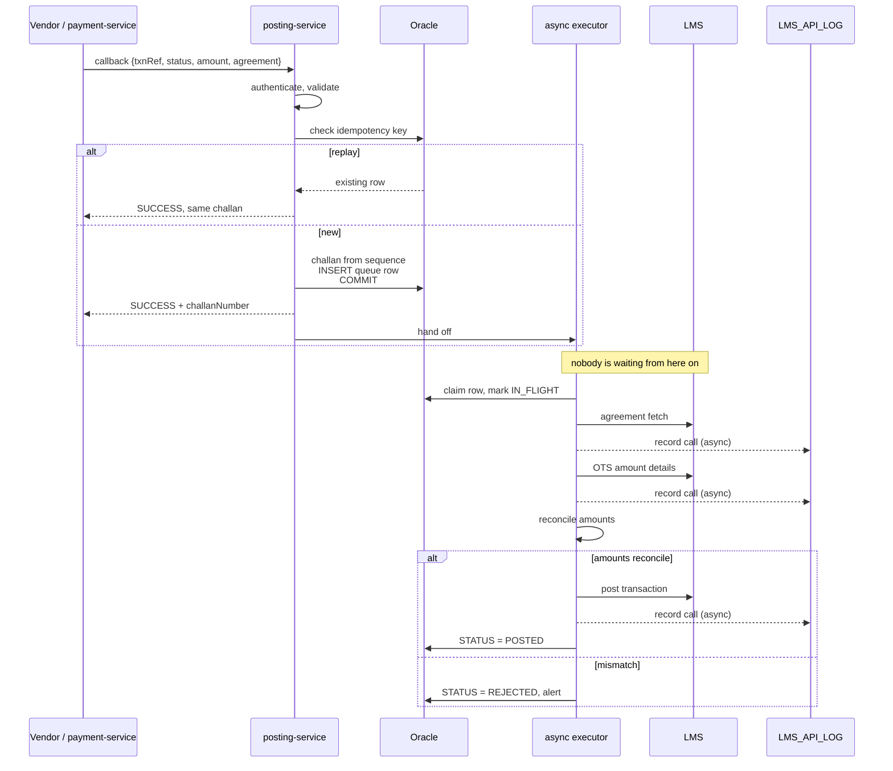

# Payment Posting Architecture

> From vendor callback to posted in the LMS. Replaces the earlier draft, which assumed a
> resumable multi-step sequence. The confirmed flow does not need one.

---

## 1. The flow, as confirmed

```
Callback arrives (SUCCESS or FAILED)
   │
   ├─ 1. INSERT row + generate challan + COMMIT
   ├─ 2. Respond immediately with the challan
   │
   └─ 3. Asynchronously:

        FIRST ATTEMPT                 RETRY
        ─────────────                 ─────
        1. Agreement fetch            1. Status check      ← the difference
        2. OTS amount details         2. Agreement fetch
        3. Post transaction           3. OTS amount details
                                      4. Post transaction
```

**The status check runs only on retry.** A first attempt cannot be a duplicate, so the
call is skipped — roughly 25% fewer LMS calls in the normal path.

### What changed from the previous draft

| Previous | Now | Why |
|---|---|---|
| Per-step state table for resumption | **Removed** | The status check on retry is the resume mechanism |
| 3-second inline wait, then queue | **Removed** | The response returns immediately after commit; everything else is async |
| Status check always first | Retry only | A first attempt cannot be a duplicate |

The response is never held for an LMS call. The challan is the commitment.

---

## 2. Sequence



---

## 3. State model

One table. The statuses are the design.

| Status | Set when | Next |
|---|---|---|
| `PENDING` | Row created, or a retry is due | Claimed by an executor |
| `IN_FLIGHT` | An executor is working it | `POSTED`, `PENDING`, `REJECTED`, or stranded |
| `POSTED` | Post transaction succeeded | Terminal |
| `REJECTED` | **Business rejection** — amounts do not reconcile, agreement invalid | Terminal, alerts |
| `NOT_APPLICABLE` | Callback status was FAILED — nothing to post | Terminal |
| `MANUAL_REVIEW` | Retries exhausted | Terminal, **pages** |

### Why `REJECTED` is separate from `MANUAL_REVIEW`

A technical failure — timeout, connection reset, LMS 500 — is worth retrying. A business
rejection is not: if the OTS amount does not reconcile with what was collected, the same
call in two minutes returns the same answer.

Retrying a business rejection sixty times burns rate-limit permits that real work needs,
and buries the one case a human must actually look at. `REJECTED` stops immediately,
records why, and alerts.

### `IN_FLIGHT` and the 60-second floor

A row marked `IN_FLIGHT` is being worked by an executor on some server. The sweeper only
reclaims `IN_FLIGHT` rows whose `CLAIMED_AT` is older than **60 seconds** — beyond the
LMS's own 30-second timeout plus margin.

Without that floor, a sweeper on server B reclaims a row an executor on server A is still
posting, and both call the LMS.

---

## 4. Two records, two purposes

Easy to collapse by accident, and worth keeping apart.

| | `PAYMENT_POSTING_QUEUE` | `LMS_API_LOG` |
|---|---|---|
| Holds | Current state of one transaction | Every LMS call ever made |
| Rows per transaction | Exactly one | One per call, across all attempts |
| Updated | Yes — status transitions | **Never** — insert only |
| Written | Synchronously, in the callback transaction | Asynchronously |
| Answers | "What still needs posting?" | "What exactly did we send, and what came back?" |

The queue is working state. The log is evidence — full request and response bodies, for
reconciliation and disputes.

**The log write must never fail the posting.** If the log insert fails, posting proceeds
and the failure is alerted. Failing a payment posting because an audit insert failed
would be the worse outcome.

---

## 5. Rate limiting

A shared Redis token bucket at `rl:lms-posting`, drawn by every executor on every server.

| | |
|---|---|
| Peak today | 300 postings/min |
| Configured ceiling | 600 postings/min |
| **LMS calls at ceiling** | **1,800/min first attempt · 2,400/min on retries** |

That last row is the number to agree with the LMS team. 600 postings/min sounds modest;
2,400 API calls a minute does not. A four-fold misunderstanding is how an agreed limit
becomes an outage.

The permit is taken **once per transaction, before the first LMS call** — not per call.
One permit covers the whole sequence, so a retry with its extra status check does not
consume two.

No permit means the row stays `PENDING` for the next cycle. Under a spike, posting slows
rather than flooding the LMS, which is the correct failure mode.

---

## 6. Retry schedule

| Attempt | When | Calls |
|---|---|---|
| 1 | immediately after commit | 3 — no status check |
| 2 | +2 min | 4 |
| 3 | +5 min | 4 |
| 4 | +15 min | 4 |
| 5 | +30 min | 4 |
| 6 | +60 min | 4 |
| — | — | → `MANUAL_REVIEW`, pages |

Escalating rather than fixed. Most transient failures clear on attempt 2, so the common
case resolves in minutes and the LMS sees fewer calls than a fixed cycle produces.

`REJECTED` exits this schedule immediately — it is not a retry case.

---

## 7. Duplicate prevention

| # | Risk | Control |
|---|---|---|
| 1 | Vendor retries the callback | `UNIQUE (PARTNER_CODE, PARTNER_IDEM_KEY)` returns the original challan |
| 2 | Two executors claim one row | `FOR UPDATE SKIP LOCKED` |
| 3 | Sweeper reclaims a live row | `IN_FLIGHT` + 60-second floor |
| 4 | Retry after an LMS timeout | Status check on every retry |
| 5 | Status check misses a just-landed post | Unique client reference on the post call |
| 6 | Kafka redelivery | `UPDATE ... WHERE STATUS = 'IN_FLIGHT'` — zero rows means done, ack anyway |

Controls 4 and 5 are layered deliberately. The status check catches the common case
cheaply. Control 5 covers the window between the check returning "not posted" and the
post landing — narrow, but at 300/min it gets hit eventually.

**Open question:** if the LMS post API is idempotent on a client reference, control 5
closes that window completely. If not, the window remains and is worth raising with them.

---

## 8. Failure modes

| Failure | Behaviour | Caller impact |
|---|---|---|
| LMS slow or down | Row stays `PENDING`, backoff, alert on queue age | None — challan already issued |
| Agreement fetch fails | Retry from the top next attempt | None |
| Amounts do not reconcile | `REJECTED`, alert, no retry | None |
| Post succeeds, response lost | Next retry's status check finds it → `POSTED` | None |
| Server dies mid-sequence | Row stranded `IN_FLIGHT`, reclaimed after 60s | None |
| Rate limit exhausted | Posting slows; the queue absorbs the spike | None |
| **Oracle down** | Cannot commit the challan — caller gets an error | Error, correctly |
| Log write fails | Posting continues, alert raised | None |

Oracle is the only failure the caller sees, and that is right: with no committed row
there is no challan, and issuing one anyway creates money with no record.

---

## 9. Schema

```sql
CREATE SEQUENCE SEQ_CHALLAN START WITH 1 INCREMENT BY 1 NOCACHE ORDER;

CREATE TABLE PAYMENT_POSTING_QUEUE (
    ID                NUMBER(19) GENERATED BY DEFAULT AS IDENTITY PRIMARY KEY,
    TXN_REFERENCE     VARCHAR2(40)  NOT NULL,
    CHALLAN_NUMBER    VARCHAR2(30)  NOT NULL,

    SOURCE            VARCHAR2(16)  NOT NULL,   -- VENDOR | BORROWER
    PARTNER_CODE      VARCHAR2(32),
    PARTNER_IDEM_KEY  VARCHAR2(80),

    AGREEMENT_NUMBER  VARCHAR2(50)  NOT NULL,
    AMOUNT            NUMBER(15,2)  NOT NULL,
    PAYMENT_MODE      VARCHAR2(24),
    VENDOR_CODE       VARCHAR2(32),
    VENDOR_TXN_REF    VARCHAR2(80),
    VENDOR_STATUS     VARCHAR2(16)  NOT NULL,   -- SUCCESS | FAILED, as received
    PAID_AT           TIMESTAMP     NOT NULL,

    STATUS            VARCHAR2(16)  NOT NULL,
    ATTEMPT_COUNT     NUMBER(5) DEFAULT 0 NOT NULL,
    NEXT_ATTEMPT_AT   TIMESTAMP     NOT NULL,
    CLAIMED_BY        VARCHAR2(64),
    CLAIMED_AT        TIMESTAMP,                -- drives the 60s stranded floor

    LMS_REFERENCE     VARCHAR2(80),             -- from the successful post
    REJECT_REASON     VARCHAR2(256),            -- why REJECTED, for the operator
    LAST_ERROR        VARCHAR2(512),

    CORRELATION_ID    VARCHAR2(36)  NOT NULL,
    CREATED_AT        TIMESTAMP     NOT NULL,
    UPDATED_AT        TIMESTAMP     NOT NULL,

    CONSTRAINT UQ_PPQ_TXNREF  UNIQUE (TXN_REFERENCE),
    CONSTRAINT UQ_PPQ_CHALLAN UNIQUE (CHALLAN_NUMBER),
    CONSTRAINT UQ_PPQ_PARTNER UNIQUE (PARTNER_CODE, PARTNER_IDEM_KEY),
    CONSTRAINT CK_PPQ_STATUS  CHECK (STATUS IN
        ('PENDING','IN_FLIGHT','POSTED','REJECTED','NOT_APPLICABLE','MANUAL_REVIEW'))
)
PARTITION BY RANGE (CREATED_AT)
INTERVAL (NUMTOYMINTERVAL(1,'MONTH'))
(PARTITION P_INITIAL VALUES LESS THAN (TIMESTAMP '2026-01-01 00:00:00'));

CREATE INDEX IX_PPQ_CLAIM     ON PAYMENT_POSTING_QUEUE (STATUS, NEXT_ATTEMPT_AT) LOCAL;
CREATE INDEX IX_PPQ_STRANDED  ON PAYMENT_POSTING_QUEUE (STATUS, CLAIMED_AT) LOCAL;
CREATE INDEX IX_PPQ_AGREEMENT ON PAYMENT_POSTING_QUEUE (AGREEMENT_NUMBER, CREATED_AT) LOCAL;


-- Every LMS call. Insert only, written asynchronously.
-- Replaces the legacy goldLogDetails table.
CREATE TABLE LMS_API_LOG (
    ID                NUMBER(19) GENERATED BY DEFAULT AS IDENTITY PRIMARY KEY,
    CORRELATION_ID    VARCHAR2(36)  NOT NULL,
    TXN_REFERENCE     VARCHAR2(40),
    ATTEMPT_NO        NUMBER(5),
    API_NAME          VARCHAR2(32)  NOT NULL,   -- STATUS_CHECK | AGREEMENT_FETCH
                                                -- | OTS_AMOUNT | POST_TXN | TOKEN
    ENDPOINT          VARCHAR2(512) NOT NULL,
    HTTP_METHOD       VARCHAR2(8)   NOT NULL,
    AGREEMENT_NUMBER  VARCHAR2(50),
    REQUEST_BODY      CLOB,
    RESPONSE_BODY     CLOB,
    HTTP_STATUS       NUMBER(5),
    UPSTREAM_STATUS   VARCHAR2(64),
    UPSTREAM_CODE     VARCHAR2(32),
    OUTCOME           VARCHAR2(16)  NOT NULL,
    ERROR_DETAIL      VARCHAR2(512),
    DURATION_MS       NUMBER(19),
    REQUESTED_AT      TIMESTAMP     NOT NULL,
    RESPONDED_AT      TIMESTAMP
)
PARTITION BY RANGE (REQUESTED_AT)
INTERVAL (NUMTOYMINTERVAL(1,'MONTH'))
(PARTITION P_INITIAL VALUES LESS THAN (TIMESTAMP '2026-01-01 00:00:00'));

CREATE INDEX IX_LOG_TXN  ON LMS_API_LOG (TXN_REFERENCE, REQUESTED_AT) LOCAL;
CREATE INDEX IX_LOG_CORR ON LMS_API_LOG (CORRELATION_ID) LOCAL;
CREATE INDEX IX_LOG_API  ON LMS_API_LOG (API_NAME, REQUESTED_AT) LOCAL;
```

Interval partitioning is not optional on `LMS_API_LOG`. With CLOBs and up to four calls
per attempt it becomes the largest table in the schema, and a retention purge without
partitions is a very expensive `DELETE` rather than a `DROP PARTITION`.

### Claim

```sql
SELECT ID FROM PAYMENT_POSTING_QUEUE
 WHERE STATUS = 'PENDING' AND NEXT_ATTEMPT_AT <= SYSTIMESTAMP
 ORDER BY NEXT_ATTEMPT_AT
 FETCH FIRST :batch ROWS ONLY
   FOR UPDATE SKIP LOCKED
```

### Stranded reclaim

```sql
UPDATE PAYMENT_POSTING_QUEUE
   SET STATUS = 'PENDING', NEXT_ATTEMPT_AT = SYSTIMESTAMP
 WHERE STATUS = 'IN_FLIGHT'
   AND CLAIMED_AT < SYSTIMESTAMP - INTERVAL '60' SECOND
```

### Completion — always conditional

```sql
UPDATE PAYMENT_POSTING_QUEUE
   SET STATUS = 'POSTED', LMS_REFERENCE = :ref, UPDATED_AT = SYSTIMESTAMP
 WHERE TXN_REFERENCE = :txn AND STATUS = 'IN_FLIGHT'
```

Zero rows affected means another executor already finished it. Not an error.

---

## 10. Observability

| Metric | Alert |
|---|---|
| Median callback-to-`POSTED` time | The number the business cares about |
| Oldest `PENDING` row age | > 30 min |
| `MANUAL_REVIEW` count | **> 0 — page.** Money collected, no loan record |
| `REJECTED` count | > 0 — needs an operator, not a retry |
| Stranded `IN_FLIGHT` reclaims | > 0 means servers dying mid-posting |
| Rate permits available | Saturation, before anything fails |
| Duration by `API_NAME` | Which of the four calls is slow |
| First-attempt success rate | How often the retry path is used at all |

---

## 11. Open questions

1. **Do FAILED callbacks post to the LMS?** This design gives them a challan and a row,
   then `NOT_APPLICABLE` with no LMS call. If a failed payment must also reach the LMS,
   that is a different path.
2. **What counts as an amount mismatch?** Exact match, or a tolerance? Decides when
   `REJECTED` fires rather than proceeding.
3. **Is the LMS post API idempotent on a client reference?** Decides whether duplicate
   control 5 closes the status-check window or merely narrows it.
4. **Is the agreed ceiling in transactions or API calls?** 600 postings/min is
   1,800–2,400 LMS calls/min.
5. **Retention for `LMS_API_LOG`?** Drives the partition purge schedule.
