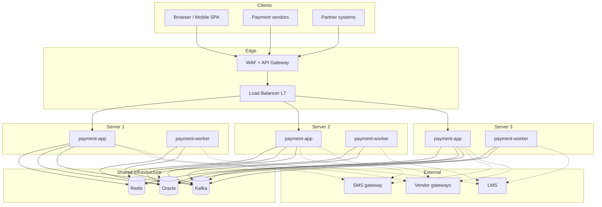
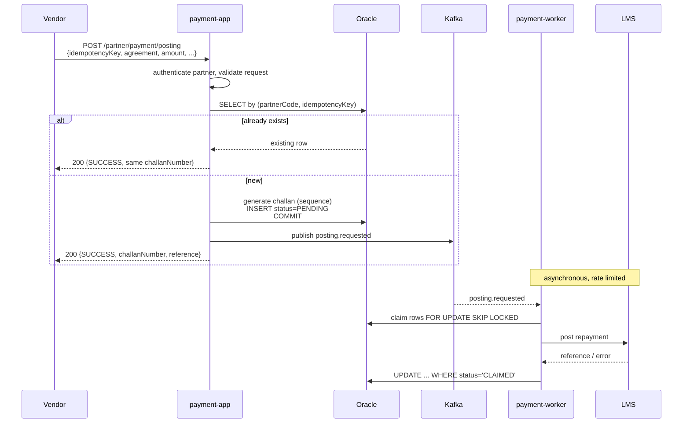
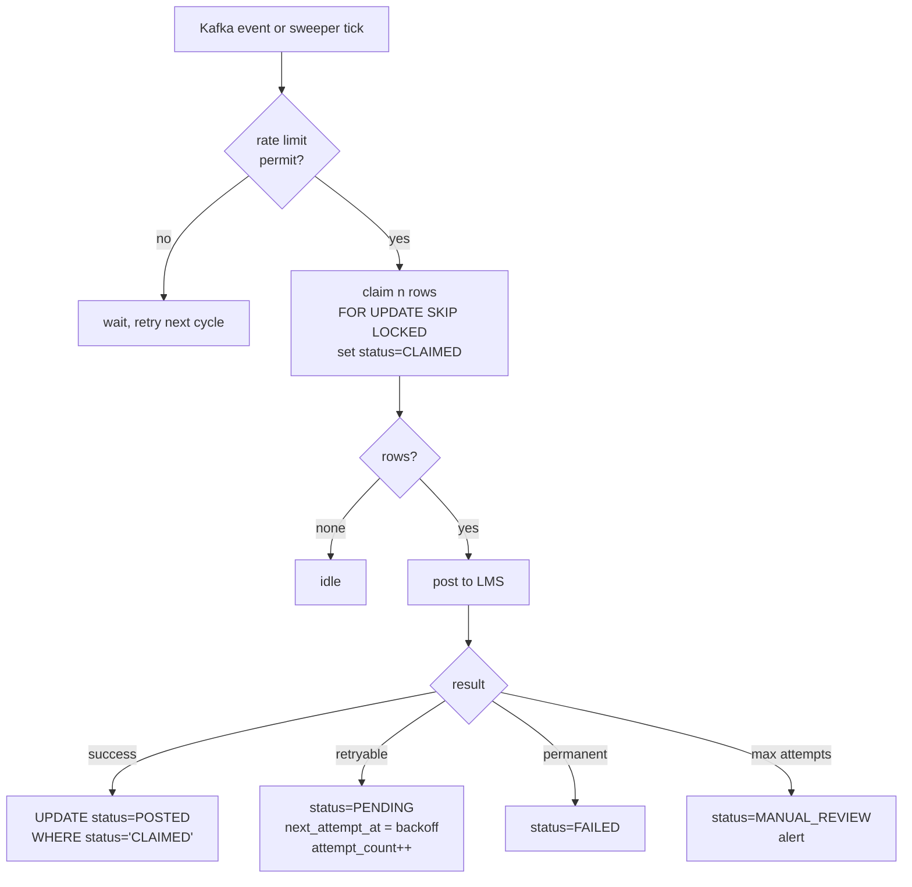

# Payment Platform — Target Architecture

> Supersedes the five-microservice diagram. Target design only; nothing here describes a
> current deployment.

---

## 1. What changed, and why

| Previous design | Now | Reason |
|---|---|---|
| 5 microservices, N instances each | 2 deployables, 1 of each per server | at ~10 journeys/sec, independent scaling buys nothing and costs a distributed transaction boundary |
| "Kafka Service" | deleted | not a bounded context; producers live with their events, consumers live in the worker |
| Vendor Direct Posting calls LMS inline | writes to the posting queue | two components posting to one external system makes duplicates unfixable |
| Scheduler as primary trigger | safety net only, 10-minute floor | Kafka triggers posting; the scheduler catches what Kafka missed |
| LMS posting confirms the vendor response | challan number confirms it | decouples the vendor's response time from an upstream you do not control |

Kept unchanged: Redis, Oracle, Kafka, Prometheus, Loki, Grafana, insert-only log tables,
the borrower authentication design, the encrypted payload model.

**The correction that drove this:** one instance per server is still multiple instances.
Three servers running one copy each is three schedulers, three consumers, three processes
racing to post the same payment. The topology changed; the concurrency did not. Every
coordination control in §5 is mandatory regardless of which topology you choose.

---

## 2. Deployment topology



Two deployables per server. The split is by **workload profile, not by domain**:

| | `payment-app` | `payment-worker` |
|---|---|---|
| Contains | auth, OTP, data fetch, payment initiation, vendor selection, status, vendor callbacks, partner API | scheduler, LMS posting, reconciliation, Kafka consumers |
| Someone waiting? | yes | no |
| Scaling signal | request latency | queue depth |
| Restart impact | borrowers see errors | backlog, no user impact |

Three reasons this boundary is worth having and the domain boundaries are not:

1. A batch draining 50 postings holds threads and connections. In the same process as
   `verify-otp`, that is latency the borrower feels.
2. Every duplicate-posting risk lives in the worker. Concentrating them in one deployable
   gives the claim logic, the unique constraints and the single-posting-path rule exactly
   one home.
3. You can pause, roll back or restart posting during an LMS outage without touching
   authentication.

**Only the worker calls the LMS posting endpoint.** Nothing else, ever.

---

## 3. Components

### `payment-app`

| Package | Responsibility |
|---|---|
| `controller` | HTTP adaptation only |
| `service` | orchestration, state transitions |
| `session` | Redis session state, compare-and-swap |
| `security` | crypto, filters, tokens |
| `client` | LMS read, SMS, vendor gateways |
| `partner` | key-to-token, scoped fetch, posting intake |

Stateless. All state in Redis or Oracle. Horizontally safe as-is.

### `payment-worker`

| Component | Trigger | Responsibility |
|---|---|---|
| Posting consumer | Kafka `payment.posting.requested.v1` | claim, post to LMS, transition |
| Posting sweeper | scheduled, 5 min | rows older than 10 min that Kafka missed |
| Reconciliation | scheduled, 30 min | unresolved vendor attempts |

All three use the same claim-and-transition primitives from §5. No leader election, no
distributed lock.

---

## 4. Flows

### 4.1 Vendor direct posting — the synchronous path



The challan number and the queue row are generated and committed in **one transaction**.
Never generate, return, then write — a crash in that gap leaves the vendor holding a
challan for a payment you have no record of, and reconciliation cannot find it because it
does not exist.

If the commit fails the vendor gets an error and retries with the same idempotency key.
That is a clean failure. The reverse order produces money you cannot account for.

### 4.2 Borrower journey

Unchanged from the existing design through payment-token issuance. After a vendor
callback confirms payment, `payment-app` writes the same posting queue row and publishes
the same event. **Both sources converge on one queue and one poster.**

### 4.3 Worker posting cycle



---

## 5. Duplicate prevention

The core of this document. Four sources, each with its own control.

| # | Source | Control |
|---|---|---|
| 1 | Scheduler running on every server | `SKIP LOCKED` claim — workers pull disjoint rows |
| 2 | Two posting paths racing | one queue, one poster; nothing else calls LMS posting |
| 3 | Kafka redelivery | conditional transition — zero rows means already done, ack anyway |
| 4 | **LMS timeout then retry** | unique client reference sent to LMS; ask them for idempotency |

Sources 1, 2 and 4 occur on a single server too. Multiple servers made them frequent, not
possible.

### Layer 1 — one identifier, end to end

Every posting carries a unique `REFERENCE_ID`, sent to the LMS as the client reference.
`UNIQUE` constraints in Oracle make a duplicate insert fail loudly rather than succeed
quietly.

**The question that determines everything else:** does the LMS posting API accept a
client reference and behave idempotently on repeat — reject as duplicate, or return the
original result?

- **Yes** → source 4 is closed and the rest is efficiency.
- **No** → the worker must query posting-by-reference before posting. Racy, far better
  than nothing, and you should push for the idempotent version because this is their
  problem to solve properly.

### Layer 2 — claim, do not select

```sql
SELECT ID
  FROM PAYMENT_POSTING_QUEUE
 WHERE STATUS = 'PENDING'
   AND NEXT_ATTEMPT_AT <= SYSTIMESTAMP
 ORDER BY NEXT_ATTEMPT_AT
 FETCH FIRST :batchSize ROWS ONLY
   FOR UPDATE SKIP LOCKED
```

Worker A locks rows, worker B skips past them to the next set. Update to `CLAIMED` in the
same transaction.

No ShedLock, no leader election, no stale lock when a server dies — the transaction ends
and the rows unlock. This replaces the distributed lock the previous design called for.

### Layer 3 — conditional transitions

Never `UPDATE ... WHERE ID = ?`. Always:

```sql
UPDATE PAYMENT_POSTING_QUEUE
   SET STATUS = 'POSTED', LMS_REFERENCE = :ref, UPDATED_AT = SYSTIMESTAMP
 WHERE REFERENCE_ID = :ref_id AND STATUS = 'CLAIMED'
```

Zero rows affected means another worker already moved it. The consumer treats that as
"already done" and acks — it is not an error. Same compare-and-swap idea as the Redis
session version, applied to Oracle.

### Kafka configuration

All workers must share `group.id=payment-posting`. **Check this first.** A hostname or
UUID in the group id — which some templates add to "avoid conflicts" — gives every
instance its own group, so every instance receives every message. That turns Kafka from
your protection into a duplicate multiplier, and it is a one-line mistake.

Ack after the database commit, never before.

---

## 6. Data model

```sql
CREATE SEQUENCE SEQ_CHALLAN START WITH 1 INCREMENT BY 1 NOCACHE ORDER;

CREATE TABLE PAYMENT_POSTING_QUEUE (
    ID                  NUMBER(19) GENERATED BY DEFAULT AS IDENTITY PRIMARY KEY,

    -- Universal unique key. Sent to the LMS as the client reference.
    REFERENCE_ID        VARCHAR2(40)  NOT NULL,

    -- Returned to the vendor as immediate confirmation. Sequence-backed, never a
    -- timestamp plus random suffix: a collision would attach one payment's
    -- confirmation to another's record.
    CHALLAN_NUMBER      VARCHAR2(30)  NOT NULL,

    SOURCE              VARCHAR2(16)  NOT NULL,   -- BORROWER | PARTNER
    PARTNER_CODE        VARCHAR2(32),
    PARTNER_IDEM_KEY    VARCHAR2(80),             -- partner's own retry key

    AGREEMENT_NUMBER    VARCHAR2(50)  NOT NULL,
    AMOUNT              NUMBER(15,2)  NOT NULL,
    PAYMENT_MODE        VARCHAR2(24),
    VENDOR_CODE         VARCHAR2(32),
    VENDOR_TXN_REF      VARCHAR2(80),
    TVSTXNID            VARCHAR2(40),             -- borrower-flow attempts only
    PAID_AT             TIMESTAMP     NOT NULL,

    STATUS              VARCHAR2(16)  NOT NULL,   -- see state machine
    ATTEMPT_COUNT       NUMBER(5)     DEFAULT 0 NOT NULL,
    NEXT_ATTEMPT_AT     TIMESTAMP     NOT NULL,
    CLAIMED_BY          VARCHAR2(64),             -- hostname, for forensics
    CLAIMED_AT          TIMESTAMP,

    LMS_REFERENCE       VARCHAR2(80),
    LAST_ERROR          VARCHAR2(512),

    CORRELATION_ID      VARCHAR2(36)  NOT NULL,
    CREATED_AT          TIMESTAMP     NOT NULL,
    UPDATED_AT          TIMESTAMP     NOT NULL,

    CONSTRAINT UQ_PPQ_REFERENCE  UNIQUE (REFERENCE_ID),
    CONSTRAINT UQ_PPQ_CHALLAN    UNIQUE (CHALLAN_NUMBER),
    -- The partner's retry key. This constraint is what makes a vendor retry return the
    -- original challan instead of creating a second payment.
    CONSTRAINT UQ_PPQ_PARTNER    UNIQUE (PARTNER_CODE, PARTNER_IDEM_KEY),
    CONSTRAINT CK_PPQ_STATUS     CHECK (STATUS IN
        ('PENDING','CLAIMED','POSTED','FAILED','MANUAL_REVIEW'))
);

-- Drives the claim query. Leading STATUS, then NEXT_ATTEMPT_AT.
CREATE INDEX IX_PPQ_CLAIM     ON PAYMENT_POSTING_QUEUE (STATUS, NEXT_ATTEMPT_AT);
CREATE INDEX IX_PPQ_AGREEMENT ON PAYMENT_POSTING_QUEUE (AGREEMENT_NUMBER, CREATED_AT);
CREATE INDEX IX_PPQ_CORR      ON PAYMENT_POSTING_QUEUE (CORRELATION_ID);
```

This table is **not** append-only — unlike the audit ledger, it is working state and must
be updated. The application user needs INSERT, SELECT and UPDATE here, and still no
DELETE.

### State machine

```
PENDING ──claim──> CLAIMED ──success──> POSTED        (terminal)
                      │
                      ├──retryable──> PENDING (backoff, attempt_count++)
                      ├──permanent──> FAILED          (terminal)
                      └──max attempts──> MANUAL_REVIEW (terminal, alerts)
```

`MANUAL_REVIEW` is deliberately terminal and deliberately noisy. A payment the LMS will
not accept is money collected with no loan record — an operations and reconciliation
problem, not something to retry silently forever.

### Stuck-claim recovery

A worker that dies mid-post leaves rows in `CLAIMED`. The sweeper reclaims any row in
`CLAIMED` with `CLAIMED_AT` older than five minutes. Safe because the LMS reference
either was or was not created, and layer 1 handles the repeat.

---

## 7. Rate limiting LMS posting

Throttling is a property of the drain rate, not a filter bolted on. Two knobs:

| Knob | Property | Effect |
|---|---|---|
| Batch size | `app.posting.batch-size` | rows claimed per cycle |
| Cycle interval | `app.posting.interval` | how often the worker runs |

Sustained rate ≈ `batch ÷ interval`. Thirty rows every ten seconds is three postings per
second. Change either value, change the rate, no code involved.

### Across three servers

| Approach | When |
|---|---|
| **Divide and accept drift** — each worker set to one-third of the target | LMS asks you to be gentle. If a server is down you post at two-thirds rate rather than exceeding the limit. |
| **Shared Redis token bucket** — one counter, all workers draw from it | LMS gives a hard ceiling with rejections. Same primitive as the OTP send budget. |

Ask the LMS which it is. Given your volumes the first is probably enough.

### Two details that matter more than the mechanism

**Backoff on rejection.** If the LMS returns a rate-limit error, push `NEXT_ATTEMPT_AT`
out exponentially. Retrying at full speed into a rate limit is how a throttle becomes an
outage.

**Monitor queue age, not just depth.**

```sql
SELECT MAX(SYSTIMESTAMP - CREATED_AT) FROM PAYMENT_POSTING_QUEUE WHERE STATUS='PENDING'
```

A rate limit means a backlog by design. Alert when the oldest pending row crosses 30
minutes: a permanently growing queue means your rate limit is below your arrival rate,
which is a business problem, not a tuning one.

**Payment fetch is not rate limited.** Borrower-facing, someone is waiting, read-only.
Its concurrency is bounded by the bulkhead instead.

---

## 8. Partner API contract

```
POST /api/v1/partner/token          key + secret → short-lived bearer
GET  /api/v1/partner/agreement/{n}  scoped agreement details
POST /api/v1/partner/payment/posting
GET  /api/v1/partner/posting/{ref}  status lookup
```

### Posting request

```json
{
  "idempotencyKey": "PARTNER-2026-09-16-0001",
  "agreementNumber": "GL0001234567",
  "amount": 3499.00,
  "paymentMode": "UPI",
  "vendorTxnRef": "UPI123456789",
  "paidAt": "2026-09-16T11:42:00+05:30"
}
```

### Response

```json
{
  "status": "SUCCESS",
  "challanNumber": "CHL2026091600001234",
  "referenceId": "PST-8f3a...",
  "message": "Payment received and recorded"
}
```

Same idempotency key returns the **same challan number**, always. That is what the
`UQ_PPQ_PARTNER` constraint is for.

### What the contract must say in writing

The challan number confirms **you have accepted and recorded the payment**, not that the
loan account is updated. Those are minutes apart normally and could be hours during an
LMS outage.

If the partner's customer-facing message says "loan updated," that is a promise neither
of you can keep, and it surfaces as a complaint rather than an alert. Get this into the
integration document, not just the API spec — most duplicate-payment incidents between
two companies trace back to nobody writing down what each response code obliges the other
party to do.

### Server-side validation, not partner-supplied truth

`amount` is validated against LMS dues with a ceiling. A partner-supplied amount that
nobody checks is the same defect as the client-supplied amount in the legacy backend.

---

## 9. Network

Three ingress paths, three hostnames, three WAF policies:

| Path | Hostname | Auth | Rate limit |
|---|---|---|---|
| Borrower | `app.example.com` | session cookie + header, OTP | per IP, tight on `/auth/*` |
| Vendor callback | `hooks.example.com` | mTLS + HMAC signature, IP allowlist | low ceiling |
| Partner API | `partner.example.com` | mTLS + API key → bearer, IP allowlist | per partner |

Detail in `NETWORK_BUILD_SPEC.md`. The partner path is a new third ingress and needs its
own ALB, certificate, WAF policy and security group. It gets no route to anything
`payment-app` owns internally.

Workers need **no ingress at all**. Egress to Oracle, Kafka and the LMS only.

---

## 10. Deployment

Per server:

```
docker compose:
  payment-app     :8443   depends on redis, oracle, kafka reachability
  payment-worker  no ports exposed
```

Both images from the same build, different entrypoint profile. Shared code as an internal
Maven artifact — the LMS client, crypto, DTOs and masking utilities are used by both.

**Shared database, ownership by table.** `PAYMENT_AUDIT_EVENTS` and
`LMS_INTERACTION_LOG` are written by both; they are append-only ledgers with no
contention. `PAYMENT_POSTING_QUEUE` is written by app (insert) and worker (update). No
service reaches into another's state through the database.

### Deploy runbook

Without an orchestrator this is a procedure, not automation:

1. Drain server 1 at the load balancer, wait for connections to finish
2. Stop `payment-app`, stop `payment-worker`
3. Deploy, start, health-check
4. Return to the load balancer
5. Repeat for servers 2 and 3

Workers can be stopped at any time — claimed rows unlock on transaction end and the
sweeper reclaims stale ones. **Write this runbook before you need it at month-end.**

---

## 11. Observability

| Metric | Why |
|---|---|
| Posting queue depth by status | backlog |
| **Oldest `PENDING` row age** | the alert that matters |
| Posting success / retry / failure rate | LMS health |
| `MANUAL_REVIEW` count | must page — money with no loan record |
| Claim batch size vs configured | contention between workers |
| LMS posting latency percentiles | rate-limit tuning |
| Kafka consumer lag | consumer health |
| `tomcat_threads_busy / max` on app | saturation |
| LMS bulkhead rejections | upstream saturation |
| Duplicate-key violations on `UQ_PPQ_*` | **a duplicate was attempted and blocked** — informational, but a spike means something upstream is misbehaving |

The last one is worth a dashboard tile. It is the only direct evidence that the duplicate
controls are doing anything.

---

## 12. Failure modes

| Failure | Behaviour | Borrower impact |
|---|---|---|
| LMS posting down | queue grows, backoff, alert on age | none — challan already issued |
| LMS fetch down | bulkhead + circuit breaker, fast controlled error | cannot start new journeys |
| One server dies | LB removes it; claimed rows unlock; sweeper reclaims | none |
| Redis down | app returns 503 | total outage, by design |
| Oracle down | app returns 503; workers idle | total outage |
| Kafka down | posting falls back to the sweeper, up to 10 min later | none |
| Worker crashes mid-post | row stuck `CLAIMED`, reclaimed after 5 min, layer 1 prevents the duplicate | none |
| Partner retries | unique constraint returns the original challan | none |

Kafka being a non-event is deliberate: it is a trigger, not the system of record. The
sweeper is the floor under it.

---

## 13. Build order

1. `PAYMENT_POSTING_QUEUE` table, challan sequence, unique constraints
2. Claim-and-transition primitives with concurrency tests against real Oracle
3. `payment-worker` as a separate deployable, posting consumer and sweeper
4. Move vendor direct posting off the inline LMS call and onto the queue
5. Partner API: token, scoped fetch, posting intake
6. Rate limiter
7. Third ingress path, WAF policy, partner onboarding
8. Reconciliation into the worker
9. Load test, especially three workers against one queue

Steps 1 and 2 are the whole point. Everything else is plumbing around them.

---

## 14. Open questions

1. **Is the LMS posting API idempotent on a client reference?** Determines whether source
   4 is closed or merely reduced. Ask today.
2. Hard rate ceiling with rejections, or a request to be gentle? Decides the limiter.
3. Partner agreement fetch — scoped to a partner's own book, or unscoped?
4. Does the partner post payments they collected, or initiate payments through you? A
   notification you reconcile against is a different system from money movement you own.
5. Challan number format — any existing convention to match?
6. LMS concurrency ceiling, for the bulkhead and server count together.
7. Cloud or on-prem, for the network spec.
