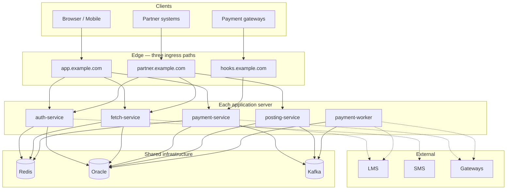
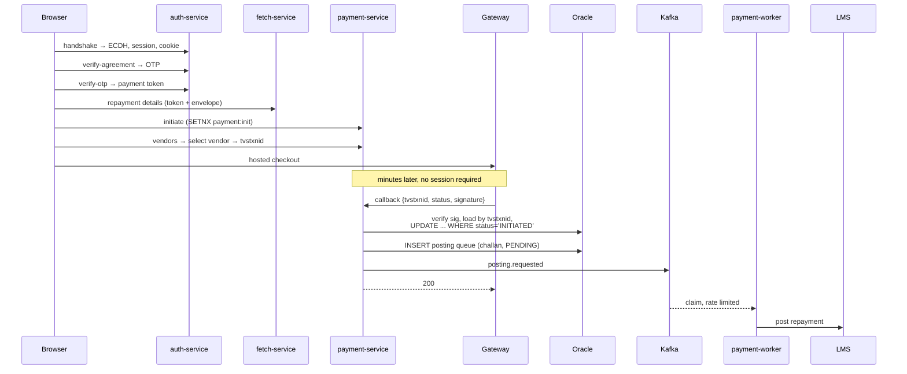
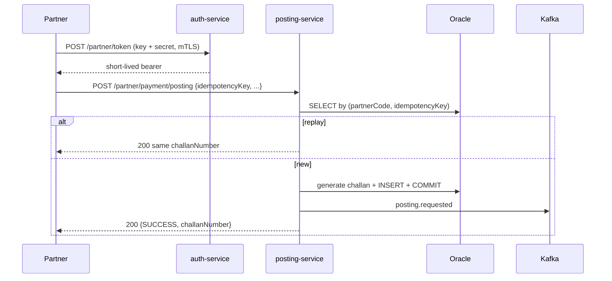

# Payment Platform — Target Architecture v2

> Five request-serving services plus one worker. Supersedes the two-deployable design.
> Target only; nothing here describes a current deployment.

---

## 1. Service boundaries

| Service | Owns | Ingress |
|---|---|---|
| `auth-service` | handshake, ECDH, OTP, browser token, partner key→token | browser, partner |
| `fetch-service` | agreement and customer details from LMS | browser, partner |
| `payment-service` | browser payment lifecycle, gateway adapters, gateway callbacks | browser, gateway |
| `posting-service` | partner direct posting intake | partner |
| `payment-worker` | queue → LMS, sweeper, reconciliation | **none** |

The boundary that makes this work is **one writer of session state**. `auth-service`
writes it; everything else reads a token and two Redis keys. Without that rule you get a
distributed monolith — four services mutating one state machine over a network.

### Why each split holds

**auth unified across browser and partner.** One credential-issuing service, two
credential types, one token format. Splitting auth per client population produces two
token schemes that drift, and the drift is discovered during an incident.

**fetch separate.** Browse-only users check dues without paying, so its traffic profile is
independent of payment. It is also the heaviest LMS consumer, which means its bulkhead
and circuit breaker should trip without affecting payment.

**payment separate.** Owns payment state and the gateway relationship. Direct vendor
traffic never reaches it — gateway callbacks do, which is different.

**posting separate.** Different auth, different trust population, machine-to-machine with
no ECDH envelope. Different blast radius.

**worker separate.** Different workload profile, and every duplicate-posting risk lives
in it.

### The cost, stated plainly

Five deployables at ~10 req/sec is real operational overhead: five pipelines, five sets
of probes, and a shared library whose version bumps ripple across four services. That is
a fair trade if team boundaries or release cadences differ per service. If one team ships
all five together, it is isolation you are paying for and not using.

---

## 2. Token and session model

The piece most likely to be got wrong.

### The token

```
PAY1.{tokenId}.{issuedAt}.{signature}

signature = HMAC-SHA256(secret, lengthPrefixed(
    version | sessionId | agreementNumber | tokenId | issuedAt ))
```

`sessionId` and `agreementNumber` are **signed, not carried**. Verification recomputes
the HMAC using the session id the request actually arrived with and the agreement the
caller is operating on. Wrong session or wrong agreement and the signature fails. The
binding is cryptographic, not a value someone reads and compares.

Length-prefixed encoding because plain `:`-separated concatenation is forgeable the
moment any field can contain the separator.

### One token per session, reusable

Issued once at OTP verification, enforced with `SETNX` on `claim:token-issue:{sid}`.
Reusable for the life of the session.

**What this gives up:** single-use enforcement. A leaked token could initiate a second
payment inside its window. The replacement control is idempotent payment initiation —
`SETNX` on `payment:init:{sid}` — so one session produces one initiation however many
times the token is presented. That is where the protection actually matters, since a
replayed token's only interesting use is starting a second payment.

Vendor selection stays repeatable: a borrower legitimately backs out of one gateway and
picks another, creating a second attempt under the same initiation.

### ECDH is unchanged

The token carries authorization. It does not and must not carry the AES key — that would
transmit the key alongside the data it protects.

Every service receiving an encrypted envelope reads the session key from Redis. That is a
single-value read, not session-state access.

### Redis key ownership

```
session:key:{sid}      AES-256 key, hex     auth writes · fetch/payment read
session:state:{sid}    state machine, CAS   auth ONLY, read and write
claim:token-issue:{sid}                     auth
payment:init:{sid}                          payment-service
nonce:{n}                                   all request-serving services
otp:*                                       auth
rl:lms-posting                              worker
```

`session:key` and `session:state` share a TTL and are deleted together, so a downstream
service that cannot read the key knows the session is gone. **Nothing outside
`auth-service` writes `session:state`**, which is what keeps the compare-and-swap intact.

### Per-request work downstream

| | Verify signature | `GET session:key` | Session state |
|---|---|---|---|
| auth | — | write | sole writer |
| fetch | yes | yes, to decrypt | no |
| payment | yes | yes, to decrypt | no |
| posting | partner token | no envelope | no |
| worker | no ingress | no | no |

One Redis read, which was needed for decryption anyway.

### TTLs

| | Value | Notes |
|---|---|---|
| Session | 5 min, **sliding** | extends on each request — 5 minutes idle, not 5 total |
| Token | same life as the session | dies with it |
| Gateway callback | **no session, no token** | resolves by `tvstxnid` in Oracle |
| Status polling | **no session** | same path, ownership checked against the payment record |

The last two matter more than they look. A borrower may spend 8 minutes at a gateway and
return to a dead session; if status polling required one, they come back to a page that
cannot tell them whether they paid.

---

## 3. Deployment topology



All five run on every server. Add servers to add capacity.

### Ingress mapping

| Hostname | Routes to | Auth |
|---|---|---|
| `app.example.com` | auth, fetch, payment | session cookie + header, token |
| `hooks.example.com` | payment-service callbacks only | mTLS + HMAC, IP allowlist |
| `partner.example.com` | auth (token), fetch (scoped), posting | mTLS + API key → token |

Three hostnames, three certificates, three WAF policies. `payment-service` is reachable
from two paths with different authentication on each, which is why its callback endpoints
must be path-restricted at the webhook ALB.

---

## 4. Flows

### 4.1 Browser payment, end to end



The callback handler must finish well inside the gateway's timeout, typically ~60
seconds. It touches only Oracle and Kafka — **never the LMS**. If it approaches the
timeout the gateway retries and you exercise the duplicate controls unnecessarily.

### 4.2 Partner direct posting



Challan generation, insert and commit are **one transaction**. Never generate, return,
then write — a crash in that gap leaves the partner holding a challan for a payment you
have no record of, unfindable by reconciliation because it does not exist.

### 4.3 Two writers, one poster

```
payment-service ──┐
                  ├──→ PAYMENT_POSTING_QUEUE ──→ payment-worker ──→ LMS
posting-service ──┘
```

Multiple writers to the queue are safe — unique constraints handle it. Multiple callers
of the LMS posting endpoint are not. `SOURCE` on the row is `BORROWER` or `PARTNER` so
reconciliation can tell them apart.

---

## 5. Reconciliation

Closes the gap when a callback is lost entirely.

### Escalating schedule, not a fixed interval

A `NEXT_CHECK_AT` column drives it:

| Check | After initiation | Why |
|---|---|---|
| 1 | +2 min | most lost callbacks resolve here |
| 2 | +5 min |  |
| 3 | +10 min |  |
| 4 | +20 min |  |
| 5 | +30 min | borrower has likely abandoned checkout |
| 6 | +45 min | last automatic attempt |
| — | +60 min | → `UNRESOLVED`, alert |

Same total window as a fixed 30-minute cycle, but the common case resolves in minutes
instead of half an hour, and it makes **fewer** vendor API calls because most transactions
resolve on the first check. Intervals are configuration.

### The terminal state is the point

A bounded retry window with no terminal state means payments silently vanish from
tracking. `UNRESOLVED` is terminal, alerts, and lands on an operator's desk with the
`tvstxnid`, the gateway, and every status response received.

### Mechanics

The reconciliation worker claims due rows with `FOR UPDATE SKIP LOCKED`, calls the
gateway's status API by `tvstxnid`, and applies the same conditional transition as the
callback path. A status response and a late callback racing each other both use
`WHERE status = 'INITIATED'`; the loser affects zero rows and is a no-op.

---

## 6. Duplicate prevention

| # | Source | Control |
|---|---|---|
| 1 | Scheduler on every server | `FOR UPDATE SKIP LOCKED` — workers claim disjoint rows |
| 2 | Two posting paths | one queue, one poster |
| 3 | Kafka redelivery | conditional transition; zero rows = already done, ack anyway |
| 4 | **LMS timeout then retry** | unique reference sent as LMS client ref |
| 5 | Callback and reconciliation racing | same conditional transition on `INITIATED` |
| 6 | Gateway callback retry | idempotent by `tvstxnid`; always return 200 |

Sources 1, 2 and 4 occur on a single server too. Multiple servers made them frequent, not
possible.

**All workers share `group.id=payment-posting`.** A hostname or UUID in the group id gives
every instance its own group and every instance every message — Kafka becomes a duplicate
multiplier. Check this first. Ack after the database commit, never before.

**Open question 1:** is the LMS posting API idempotent on a client reference? If yes,
source 4 is closed. If no, the worker needs a query-before-post step, which is racy and
worth pushing back to them about.

---

## 7. Data model

```sql
CREATE SEQUENCE SEQ_CHALLAN START WITH 1 INCREMENT BY 1 NOCACHE ORDER;

CREATE TABLE PAYMENT_POSTING_QUEUE (
    ID                  NUMBER(19) GENERATED BY DEFAULT AS IDENTITY PRIMARY KEY,
    REFERENCE_ID        VARCHAR2(40)  NOT NULL,   -- LMS client reference
    CHALLAN_NUMBER      VARCHAR2(30)  NOT NULL,   -- returned to the partner
    SOURCE              VARCHAR2(16)  NOT NULL,   -- BORROWER | PARTNER
    PARTNER_CODE        VARCHAR2(32),
    PARTNER_IDEM_KEY    VARCHAR2(80),
    AGREEMENT_NUMBER    VARCHAR2(50)  NOT NULL,
    AMOUNT              NUMBER(15,2)  NOT NULL,
    PAYMENT_MODE        VARCHAR2(24),
    VENDOR_CODE         VARCHAR2(32),
    VENDOR_TXN_REF      VARCHAR2(80),
    TVSTXNID            VARCHAR2(40),
    PAID_AT             TIMESTAMP     NOT NULL,
    STATUS              VARCHAR2(16)  NOT NULL,
    ATTEMPT_COUNT       NUMBER(5)     DEFAULT 0 NOT NULL,
    NEXT_ATTEMPT_AT     TIMESTAMP     NOT NULL,
    CLAIMED_BY          VARCHAR2(64),
    CLAIMED_AT          TIMESTAMP,
    LMS_REFERENCE       VARCHAR2(80),
    LAST_ERROR          VARCHAR2(512),
    CORRELATION_ID      VARCHAR2(36)  NOT NULL,
    CREATED_AT          TIMESTAMP     NOT NULL,
    UPDATED_AT          TIMESTAMP     NOT NULL,

    CONSTRAINT UQ_PPQ_REFERENCE UNIQUE (REFERENCE_ID),
    CONSTRAINT UQ_PPQ_CHALLAN   UNIQUE (CHALLAN_NUMBER),
    -- What makes a partner retry return the original challan instead of a
    -- second payment. One line of DDL; the whole integration rests on it.
    CONSTRAINT UQ_PPQ_PARTNER   UNIQUE (PARTNER_CODE, PARTNER_IDEM_KEY),
    CONSTRAINT CK_PPQ_STATUS    CHECK (STATUS IN
        ('PENDING','CLAIMED','POSTED','FAILED','MANUAL_REVIEW'))
);

CREATE INDEX IX_PPQ_CLAIM ON PAYMENT_POSTING_QUEUE (STATUS, NEXT_ATTEMPT_AT);

CREATE TABLE PAYMENT_ATTEMPT (
    ID                NUMBER(19) GENERATED BY DEFAULT AS IDENTITY PRIMARY KEY,
    TVSTXNID          VARCHAR2(40)  NOT NULL,
    PAYMENT_INIT_ID   VARCHAR2(40)  NOT NULL,
    SESSION_REF       VARCHAR2(32)  NOT NULL,   -- hash, for ownership checks
    AGREEMENT_NUMBER  VARCHAR2(50)  NOT NULL,
    AMOUNT            NUMBER(15,2)  NOT NULL,
    VENDOR_CODE       VARCHAR2(32)  NOT NULL,
    STATUS            VARCHAR2(20)  NOT NULL,   -- INITIATED|SUCCESS|FAILED|UNRESOLVED
    NEXT_CHECK_AT     TIMESTAMP,
    CHECK_COUNT       NUMBER(5) DEFAULT 0 NOT NULL,
    CREATED_AT        TIMESTAMP     NOT NULL,
    UPDATED_AT        TIMESTAMP     NOT NULL,
    CONSTRAINT UQ_PA_TVSTXNID UNIQUE (TVSTXNID)
);

CREATE INDEX IX_PA_RECON ON PAYMENT_ATTEMPT (STATUS, NEXT_CHECK_AT);
```

`CHALLAN_NUMBER` comes from the sequence, never a timestamp plus random suffix — a
collision attaches one payment's confirmation to another borrower's record, discovered
through a complaint rather than an alert.

`SESSION_REF` is a hash, so status polling can verify ownership without a live session.

### Claim query

```sql
SELECT ID FROM PAYMENT_POSTING_QUEUE
 WHERE STATUS = 'PENDING' AND NEXT_ATTEMPT_AT <= SYSTIMESTAMP
 ORDER BY NEXT_ATTEMPT_AT
 FETCH FIRST :batch ROWS ONLY
   FOR UPDATE SKIP LOCKED
```

No lock service, no leader election. A server dying mid-cycle unlocks its rows when the
transaction ends; the sweeper reclaims anything `CLAIMED` for over 5 minutes.

### Conditional transition

```sql
UPDATE PAYMENT_POSTING_QUEUE
   SET STATUS = 'POSTED', LMS_REFERENCE = :ref, UPDATED_AT = SYSTIMESTAMP
 WHERE REFERENCE_ID = :id AND STATUS = 'CLAIMED'
```

Zero rows means another worker won. Not an error.

---

## 8. Rate limiting LMS posting

A property of the drain rate, not a filter: sustained rate ≈ `batch size ÷ cycle
interval`. Thirty rows every ten seconds is three per second.

Across N servers, either divide the target N ways (simple; a server down means
two-thirds rate rather than exceeding the limit) or share a Redis token bucket at
`rl:lms-posting` if the LMS enforces a hard ceiling with rejections. Ask them which.

**Backoff on rejection** — push `NEXT_ATTEMPT_AT` out exponentially. Retrying at full
speed into a rate limit turns a throttle into an outage.

**Alert on queue age, not depth:**
`MAX(SYSTIMESTAMP - CREATED_AT) WHERE STATUS='PENDING'` over 30 minutes. A backlog is by
design; a growing one means your rate limit is below your arrival rate, which is a
business problem.

Fetch is not rate limited — borrower-facing, read-only, bounded by its bulkhead instead.

---

## 9. Shared library

Internal Maven artifact, versioned. Without it you get four copies of the LMS client that
drift, and the day the LMS changes a field you fix three and miss one.

Contains: token verification, session-key read path and key-name constants, ECDH and
AES-GCM services, envelope advices, LMS client, posting-queue entity and repository,
DTOs, masking, correlation-id filter.

**It is load-bearing infrastructure, not a convenience.** Changing the session key format
is a coordinated release across four services.

---

## 10. Observability

| Metric | Why |
|---|---|
| Oldest `PENDING` posting row age | the alert that matters |
| `MANUAL_REVIEW` count | page — money with no loan record |
| `UNRESOLVED` payment count | page — payment status never determined |
| Reconciliation checks per outcome | is escalation working |
| Unique-constraint violations on `UQ_PPQ_*` | duplicates attempted and blocked |
| Gateway callback signature failures | attack signal |
| LMS bulkhead rejections per service | upstream saturation |
| `tomcat_threads_busy / max` per service | saturation |
| Kafka consumer lag | consumer health |
| `AUDIT WRITE FAILED` | control failure, not an error |

Correlate across services by correlation id, propagated in the header and carried on every
audit and interaction row.

---

## 11. Failure modes

| Failure | Behaviour | Borrower impact |
|---|---|---|
| auth-service down | no new sessions | existing journeys continue until TTL |
| fetch-service down | details unavailable | cannot view dues; payment still works |
| payment-service down | no new payments; **callbacks fail** | gateway retries; reconciliation catches the rest |
| posting-service down | partner gets errors and retries | none |
| worker down | queue grows | none — challan already issued |
| Redis down | 503 across request-serving services | total outage, by design |
| Oracle down | 503; workers idle | total outage |
| Kafka down | posting falls back to the sweeper | up to 10 min later |
| LMS fetch down | bulkhead + breaker, controlled error | cannot start journeys |
| LMS posting down | queue grows, backoff, alert on age | none |

`payment-service` being down failing callbacks is the sharpest one. The gateway retries,
and reconciliation's 2-minute first check catches what the retries miss — which is the
argument for the escalating schedule rather than a 30-minute cycle.

---

## 12. Build order

1. Shared library: token format, session-key read path, crypto
2. `PAYMENT_POSTING_QUEUE`, challan sequence, unique constraints
3. Claim-and-transition primitives, with concurrency tests against real Oracle
4. `auth-service` with the new token format
5. `fetch-service`
6. `payment-service`: lifecycle, gateway adapters, **callback signature verification**
7. `payment-worker`: posting consumer, sweeper
8. `posting-service` and the partner ingress
9. Reconciliation with the escalating schedule
10. Rate limiter
11. Load test: N workers against one queue, callback storms, LMS degradation

Steps 2 and 3 are the point. Step 6's signature verification is the single highest-value
control in the platform — the legacy implementation's `verifyGatewaySignature` returned
`true` and its result was ignored, which is a forgeable payment success reachable by
anyone who can guess a transaction id.

---

## 13. Open questions

1. **Is LMS posting idempotent on a client reference?** Decides whether duplicate source 4
   is closed or merely reduced.
2. Hard LMS rate ceiling, or a request to be gentle? Decides the limiter.
3. Partner agreement fetch — scoped to their own book, or unscoped?
4. Does the partner notify you of payments they collected, or initiate money movement
   through you? Different systems.
5. Each gateway's callback retry policy and status API contract.
6. LMS concurrency ceiling → bulkhead limits and server count together.
7. Cloud or on-prem, for the network spec.
8. Challan number format — any existing convention to match?
